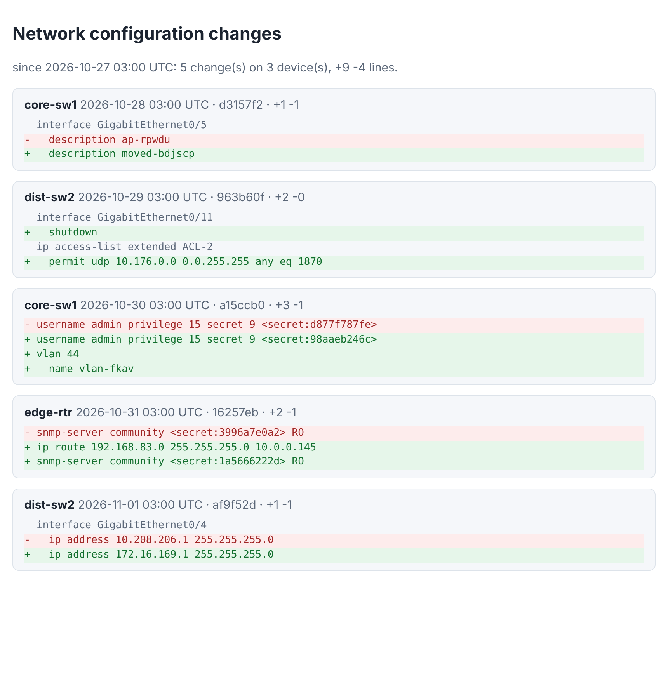

# cfgtrack

Back up network device configurations into Git and see what **really** changed.

Switches, routers and firewalls print a timestamp, a byte count or a clock counter in every configuration they show,
so `git diff` on two backups is never empty, and the real change (a new ACL line, a shutdown port) is lost in noise.
cfgtrack fetches the configuration, removes the noise, replaces passwords by tags that never leave your machine, and
commits only when something real changed, with a diff that says *which section* changed.



## What it does

- **Fetches** over SSH (one command, or an interactive session for devices that insist), HTTP, any program, or from a file.
- **Cleans**: lines that change on every run (`! Last configuration change at ...`, `ntp clock-period`, `Current
  configuration : N bytes`) are dropped. Passwords, community strings and keys become `<secret:xxxxxxxxxx>`, an HMAC
  with a key that stays outside the repository: a rotation is still a visible change, the value is nowhere.
- **Stores** one file per device in a Git repository, one commit per real change, with the changed sections in the
  commit message.
- **Diffs by section**, not by line: `interface GigabitEthernet0/1` / `- description uplink` / `+ description
  uplink-core`. Order inside a section counts (access lists), and Cisco IOS (indented), Junos (braces) and RouterOS
  (paths) are understood.
- **Refuses garbage**: an empty answer, an error message, a configuration that is cut off, or one that shrank to a
  fraction of the previous one is reported as an error and **not** stored, so the history is never overwritten by a
  broken session.
- **Reports** what changed in the last N days as Markdown, JSON or one self-contained HTML page; `status` tells which
  devices have not been backed up lately; exit codes fit cron and monitoring.

## Quick start

```bash
git clone https://github.com/TexAlphaWolf/net-config-backup-diff && cd net-config-backup-diff
pip install ".[ssh]"                   # needs git; paramiko only for SSH devices
cfgtrack init-config                   # writes cfgtrack.toml: edit the devices
cfgtrack hostkey 192.0.2.10            # prints the SSH fingerprint to pin in the file
export CORE_SW1_PASSWORD=...           # credentials come from the environment, never from the file
cfgtrack backup --diff                 # run it from cron
cfgtrack report --since 7d --format html --output changes.html
```

or with Docker (the image runs as a normal user, read-only, no capabilities; everything lives in the `/data` volume):

```bash
docker build -t cfgtrack .
docker run --rm -v cfgtrack-data:/data -e CORE_SW1_PASSWORD cfgtrack backup
```

`/data/cfgtrack.toml` is the configuration; the backups are the Git repository in `/data/backups`.

## Commands

| command | what it does |
|---|---|
| `backup [DEVICE...]` | fetch, clean, store what changed. `--diff` prints the changes, `--fail-on-change` exits 1 if any, `--accept-shrink DEVICE` stores a configuration that got much smaller on purpose |
| `diff DEVICE [--from REV --to REV]` | what changed between two revisions (default: the last two), as text or JSON |
| `log DEVICE` | the history of one device |
| `show DEVICE [--rev REV]` | a stored configuration, the latest or any older one |
| `report --since 7d [--format md\|json\|html]` | every change of every device in a period |
| `status` | last backup per device; exit 1 if one is stale or failing |
| `noise DEVICE` | suggests `ignore` patterns for lines that change on every backup (for devices a profile does not know) |
| `verify` | checks the stored files for passwords the rules do not catch |
| `hostkey HOST` | prints the SSH host key fingerprint to pin |

Exit codes: 0 fine, 1 a problem worth an alert (a device failed, or a change with `--fail-on-change`), 2 a mistake in
how it was called or configured.

## Configuration

```toml
[store]
path = "backups"
stale_after = "2d"

[[device]]
name = "core-sw1"
profile = "cisco_ios"          # cisco_ios | junos | routeros | generic
fetch = "ssh"
host = "192.0.2.10"
username = "backup"
password_env = "CORE_SW1_PASSWORD"
host_key = "SHA256:..."        # from: cfgtrack hostkey 192.0.2.10
ignore = ['^\s*system-uptime ']                 # extra noise
redact = ['license-key=(?P<secret>\S+)']       # extra secrets: the group named "secret" is replaced
```

A fuller file is in [`examples/cfgtrack.toml`](examples/cfgtrack.toml). The file is validated strictly: unknown keys are
errors, and a `password`, `token` or `secret` written in it is refused.

## Measured

On a simulated network with changes injected at known places (40 devices, 60 days, a real SSH server on loopback; details
in [`docs/evaluation.md`](docs/evaluation.md)):

- **271 of 271** real changes found; **0 commits** on 2022 days where only the noise changed (a "commit what the device
  prints" baseline: 2022).
- The reported lines matched the injected ones **exactly** in 232 of 232 non-reordering changes (each under the right
  section); all 39 reorderings of access lists were reported as changes of that list.
- **67 of 67** fetches that were not configurations (cut off, empty, an error, tiny) were held back; the baseline stored them all.
- **0 of 374** passwords in the Git history; the baseline: 374 of 374.
- The repository is 5.7 times smaller than the baseline's (207 KiB against 1190 KiB), and a quiet pass over 100 devices
  takes 0.25 s without the network.
- A device with noise no profile knows: 20 commits in 20 days with no real change; `cfgtrack noise` suggested exactly the two
  patterns, and 18 quiet days then made 0 commits while a real edit was still found.

These come from a generator that prints configurations the way Cisco IOS does. They show that the machinery works; for
another device you may need `ignore`/`redact` patterns ([limitations](docs/limitations.md)).

## Security

Read [`SECURITY.md`](SECURITY.md). In short: no password in any file, SSH host keys are pinned and never accepted blindly,
no shell is involved, revisions and names are validated, and secrets never reach the repository. **The redaction is a
safety net, not a guarantee** (a secret in a format nobody wrote a rule for is stored as it is): keep the repository
private, and run `cfgtrack verify`. Because secrets are not stored, the repository is a record of changes, not a way to
restore a device.

## More

- [Architecture](docs/architecture.md) and the reasons for the choices
- [Evaluation](docs/evaluation.md) with every number above
- [Limitations](docs/limitations.md)
- Tests: `pip install -e ".[dev]" && pytest -n auto --cov` (SSH is tested against a real SSH server, not mocks)

MIT license - Luca Tessitore
