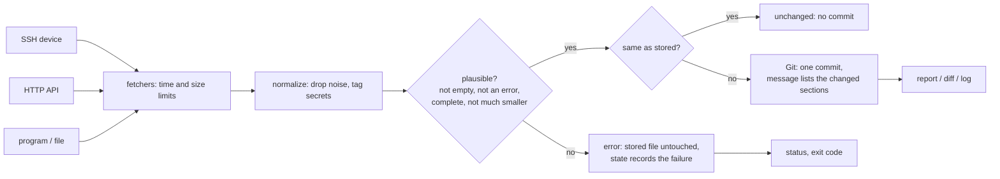

# Architecture

| module | job |
|---|---|
| `config.py` | strict TOML: unknown keys, plaintext secrets, SSH without a host key are errors |
| `profiles.py` | per device kind: noise patterns, secret patterns, how sections nest, how a complete configuration ends |
| `normalize.py` | line endings, noise, secrets to HMAC tags, plausibility check |
| `fetchers.py` | SSH (paramiko; exec or interactive shell, pinned host key), HTTP, command (no shell), file |
| `diffing.py` | three parsers (indent, braces, sections) into a tree; section-by-section sequence diff |
| `store.py` | the Git repository: one file per device, hardened `git` calls, validated names and revisions |
| `runner.py` | one pass: parallel fetch, then device by device the decision (new / unchanged / changed / error / suspect) |
| `noise.py` | proposes `ignore` patterns from the history of a device |
| `render.py`, `cli.py` | Markdown / JSON / HTML reports, status; the commands |

## Why it is built this way

**Git, not a database.** The history of a configuration is a list of versions with authorship and dates; Git is the
tool people already have for reading and sharing that, and the repository can be pushed to a private remote. cfgtrack
calls the `git` program (a few processes per stored change) instead of a library, with the user's own configuration,
hooks and signing switched off so that the result does not depend on the machine.

**Tags instead of deleting secrets.** Dropping a password line would hide the fact that it was rotated. Replacing the
value with `HMAC-SHA256(key, value)` (40 bits shown) keeps the line, keeps a change visible, and cannot be reversed
without the key. The key lives outside the repository; losing it costs one round of noisy commits, not data.

**A tree, not a list of lines.** `git diff` reports line numbers; a reviewer needs the section. The three parsers turn
indentation, braces or `/path` headers into a tree, and the diff compares the children of equal parents in order, so
`shutdown` under `interface A` and under `interface B` are different things, and a section that exists on one side only is
reported line by line with its parents as the path.

**Refuse before storing.** The worst outcome of a backup tool is replacing a good backup with a broken one without anyone
noticing. A fetch is checked before it is compared to the stored version, and a failure keeps the old file, counts in
`status` and sets the exit code.

**Host keys are pinned.** An SSH client that accepts any key sends the password to whoever answers. The configuration
requires a pinned fingerprint or a `known_hosts` file, and the tests check that a server with another key never sees a
password.

**Noise is data.** A new device kind is learned from its own history: `noise` finds the lines of the same shape that were
replaced in most commits and proposes a pattern, which a person reads and adds.
